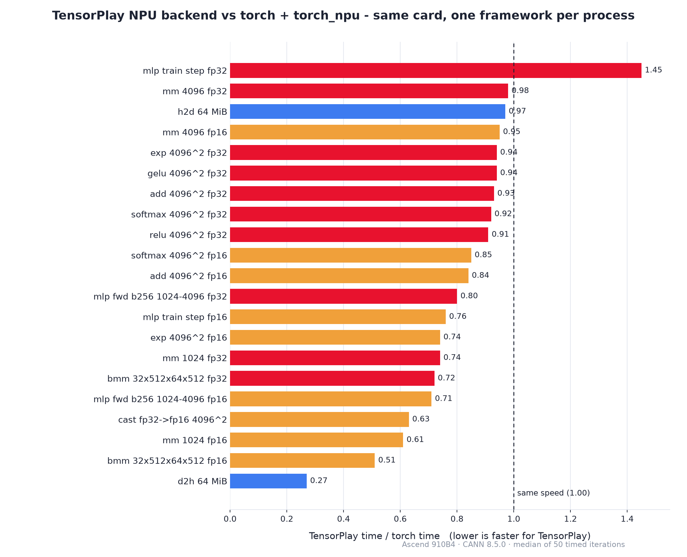

<p align="center">
  <picture>
    <source media="(prefers-color-scheme: dark)" srcset="docs/images/npu-lockup-white.png">
    <source media="(prefers-color-scheme: light)" srcset="docs/images/npu-lockup.png">
    
  </picture>
</p>

<h1 align="center">tensorplay-npu</h1>

**Huawei Ascend NPU backend for [TensorPlay]** — a native, out-of-tree device
backend that makes TensorPlay run on Ascend NPUs through the CANN runtime and
the Ascend operator library.

```python
import tensorplay as tp
import tensorplay_npu            # compiles the native part on first load

x = tp.randn(64, 64, device="npu")
y = (x @ x).relu().sum()
print(y.item())
```

[](LICENSE)
[](https://www.python.org/)
[](https://github.com/lexing-2026/TensorPlay)

<p align="center"><a href="./README.md"><strong>English</strong></a> · <a href="./README.zh.md">中文</a></p>

---

## What this is

TensorPlay reserves one out-of-tree device slot (`PrivateUse1`) for
accelerators that live outside the framework.  This package fills that slot
for Huawei Ascend NPUs:

- memory comes from the Ascend runtime through a **caching allocator**;
- operators run as **operator-library calls** (single-operator `aclnn`
  entries) on the device;
- every operator without an NPU kernel yet runs on the **host** through the
  generic fallback, so models work end to end from day one;
- the device is spelled `"npu"` in TensorPlay (`tp.ones(3, device="npu")`).

The native sources ship inside the wheel and are compiled against the
installed CANN toolkit the first time the backend is loaded, then cached
under `~/.cache/tensorplay_extensions`.

## Installation

### Requirements

- a Huawei Ascend NPU with the driver and firmware installed
  (`npu-smi info` lists the card)
- the **CANN toolkit** (runtime, compiler and operator library — see the
  Ascend documentation for your card)
- TensorPlay installed in the same environment (`pip install tensorplay`)

### Environment variables

```bash
export ASCEND_TOOLKIT_HOME=/usr/local/Ascend/cann-8.5.0   # CANN install path
export LD_LIBRARY_PATH=$ASCEND_TOOLKIT_HOME/lib64:$LD_LIBRARY_PATH
```

### Install the package

```bash
git clone https://github.com/ohtensorplay/tensorplay-npu.git
cd tensorplay-npu
pip install .            # or: pip install -e .
```

`import tensorplay` auto-loads the backend through the `tensorplay.backends`
entry point when `$ASCEND_TOOLKIT_HOME` holds the toolkit.  You can also load
it explicitly:

```python
import tensorplay_npu
tensorplay_npu.load()
```

### Verify

```python
import tensorplay as tp
import tensorplay_npu

tensorplay_npu.load()
a = tp.randn(2, 3, device="npu")
print((a.abs().sum()).cpu().item())   # needs an Ascend NPU
```

## Quick start

```python
import tensorplay as tp
import tensorplay_npu

tensorplay_npu.load()
tp.manual_seed(0)

x = tp.randn(256, 256, device="npu")
w = tp.randn(256, 256, device="npu")

y = x @ w                # native matrix product
z = y.relu().softmax(-1) # activations and reductions
loss = z.sum()
loss.backward()          # autograd works through the backend

print(z.cpu().shape, float(loss.cpu()))
```

## Supported operations

The backend implements the hot paths natively on the device:

| Area | Operators |
| --- | --- |
| Memory | `empty`, `*_like`, `empty.memory_format`, `copy_` (host/device, casts, broadcasting), `fill_`, `zero_`, `clone`, `contiguous`, `item` |
| Binary | `add`/`sub`/`mul`/`div` with broadcasting, in-place and scalar forms, `pow` (tensor-scalar), `rsub` |
| Unary | `exp`, `log`, `sqrt`, `rsqrt`, `neg`, `abs`, `relu`, `sigmoid`, `tanh`, `silu`, `gelu` and their backward kernels |
| Blas | `mm`, `addmm`, `bmm`, `matmul`, `linear` (transposed operands read in place) |
| Reduce | `sum`, `mean`, `softmax`/`log_softmax` with backward |
| Profiling | per-operation device time, device memory events |

The device computes in `float32`, `float16` and `bfloat16`.  Everything else
runs on the host through `cpu_fallback::register_host_fallbacks`, so **every
model runs**; data types the device does not take (integers, `float64`,
`bool`) take the host path as well.

## Performance

`benchmark/bench_npu_vs_torch.py` in the TensorPlay repository runs this
backend against `torch + torch_npu` on the same card, one framework per
process, identical workloads.  The chart below shows the ratio on an Ascend
910B4 (CANN 8.5.0, median of 50 timed iterations); values below 1.00 mean
TensorPlay is faster:

<p align="center">
  <picture>
    <source media="(prefers-color-scheme: dark)" srcset="docs/images/benchmark-ratio-dark.png">
    <source media="(prefers-color-scheme: light)" srcset="docs/images/benchmark-ratio.png">
    
  </picture>
</p>

Representative numbers:

| Case | torch ms | tensorplay ms | tp/torch |
| --- | ---: | ---: | ---: |
| mm 4096 fp32 | 2.135 | 2.102 | 0.98 |
| mm 1024 fp32 | 0.093 | 0.068 | 0.74 |
| add 4096² fp32 | 0.378 | 0.352 | 0.93 |
| relu 4096² fp32 | 0.259 | 0.236 | 0.91 |
| gelu 4096² fp32 | 0.257 | 0.240 | 0.94 |
| exp 4096² fp32 | 0.257 | 0.240 | 0.94 |
| softmax 4096² fp32 | 0.266 | 0.246 | 0.92 |
| bmm 32×512×64×512 fp32 | 0.075 | 0.054 | 0.72 |
| mm 4096 fp16 | 0.621 | 0.589 | 0.95 |
| mlp fwd b256 1024-4096 fp16 | 0.217 | 0.153 | 0.71 |
| mlp train step fp16 | 1.260 | 0.963 | 0.76 |
| h2d 64 MiB | 2.998 | 2.903 | 0.97 |
| d2h 64 MiB | 10.354 | 2.841 | 0.27 |
| mlp train step fp32 | 1.238 | 1.800 | 1.45 |

Elementwise, matrix, reduction and copy operators are at or ahead of
`torch_npu`; device→host copies are about 3.6× faster and the fp16 training
step is about 24% faster.  The fp32 training step is the one case that still
trails.  Full results are reproducible with:

```bash
cd <tensorplay-repo>
python benchmark/bench_npu_vs_torch.py --per-case
```

## Profiling

```python
from tensorplay.profiler import profile, ProfilerActivity

with profile(activities=[ProfilerActivity.CPU, ProfilerActivity.PrivateUse1]) as prof:
    train_step()
print(prof.key_averages().table(sort_by="device_time_total", row_limit=10))
```

Each operation gets its NPU time from an event pair recorded around it on the
device's stream; the elapsed times are read when the profile stops, so the
dispatch path never waits on the device.  Device allocations show up in
`prof.mem_events`, and `profile(use_device="npu")` asks for the same device
timing.  Kernel-level activity records are not collected — the per-operation
event pairs are the device timeline.

## Repository layout

| Path | Role |
| --- | --- |
| `tensorplay_npu/csrc/AscendRuntime.*` | error checking, per-device stream, current device, byte copies |
| `tensorplay_npu/csrc/AscendAllocator.*` | caching allocator over `aclrtMalloc`, memory statistics |
| `tensorplay_npu/csrc/AscendHooks.cpp` | device count, synchronization, byte copies, memory info |
| `tensorplay_npu/csrc/AscendTensor.*` | ACL tensor descriptors, dtype and layout rules |
| `tensorplay_npu/csrc/AscendOpApi.*` | operator-library lookup, workspaces, execution |
| `tensorplay_npu/csrc/CopyKernels.cpp` | `empty`, `*_like` factories, `copy_`, `fill_`, `clone` |
| `tensorplay_npu/csrc/BinaryKernels.cpp` | add/sub/mul/div with broadcasting, in-place and scalar forms |
| `tensorplay_npu/csrc/UnaryKernels.cpp` | exp/log/sqrt/..., activations and their backward kernels |
| `tensorplay_npu/csrc/MatmulKernels.cpp` | `mm`, `addmm`, `bmm`, `matmul`, `linear` |
| `tensorplay_npu/csrc/ReduceKernels.cpp` | `sum`, `mean`, softmax/log-softmax with backward |
| `tensorplay_npu/csrc/NPUProfiler.cpp` | profiler device time: an event pair around each operation |
| `tensorplay_npu/csrc/Module.cpp` | C entry points: host fallbacks, memory statistics |
| `tests/` | kernel-by-kernel comparison against the host |

## Versioning and compatibility

`tensorplay-npu` is versioned independently of TensorPlay (semver, see
`pyproject.toml`).  It targets the out-of-tree device slot TensorPlay
reserves for accelerators, so the two projects move at their own pace:

| Component | Version / branch |
| --- | --- |
| `tensorplay-npu` | `0.1.0` (this repository, `main`) |
| TensorPlay | any release that ships the `PrivateUse1` slot (`pip install tensorplay`) |
| CANN toolkit | `8.5.0` (the version this backend is tested against) |
| Tested card | Ascend 910B4 |

The native sources are compiled against the installed toolkit on first load
and cached under `~/.cache/tensorplay_extensions`, so a `pip install -U
tensorplay-npu` picks up new kernels without rebuilding TensorPlay.

## Development

The test suite compares every kernel against the host and needs an Ascend NPU
with the CANN toolkit:

```bash
pip install pytest
pytest tests
```

How the out-of-tree slot works is documented in [Adding a device backend] in
the TensorPlay repository.

## License

[Apache License 2.0](LICENSE).

*Huawei and Ascend are trademarks of Huawei Technologies Co., Ltd.  This
project is not affiliated with or endorsed by Huawei.*

[TensorPlay]: https://github.com/lexing-2026/TensorPlay
[Adding a device backend]: https://github.com/lexing-2026/TensorPlay/blob/main/docs/source/notes/backends.md
