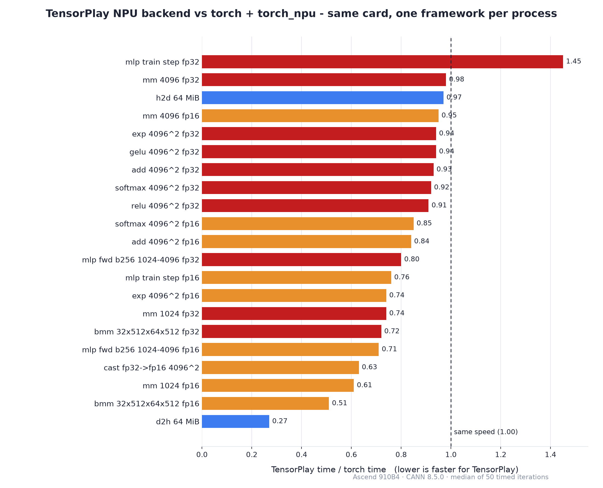

<p align="center">
  <picture>
    <source media="(prefers-color-scheme: dark)" srcset="docs/images/npu-lockup-white.png">
    <source media="(prefers-color-scheme: light)" srcset="docs/images/npu-lockup.png">
    
  </picture>
</p>

<h1 align="center">tensorplay-npu</h1>

**TensorPlay 的华为昇腾 NPU 后端** —— 一个原生的、仓库外的设备后端，通过
CANN 运行时与昇腾算子库让 TensorPlay 跑在昇腾 NPU 上。

```python
import tensorplay as tp
import tensorplay_npu            # 首次加载时编译原生部分

x = tp.randn(64, 64, device="npu")
y = (x @ x).relu().sum()
print(y.item())
```

[](LICENSE)
[](https://www.python.org/)
[](https://github.com/lexing-2026/TensorPlay)

<p align="center"><a href="./README.md">English</a> · <a href="./README.zh.md"><strong>中文</strong></a></p>

---

## 简介

TensorPlay 为框架之外的加速器预留了一个设备槽位（`PrivateUse1`）。本包为华为
昇腾 NPU 填充该槽位：

- 内存来自昇腾运行时，通过**缓存分配器**管理；
- 算子以**算子库调用**（单算子 `aclnn` 接口）在设备上执行；
- 尚未提供 NPU 内核的算子会通过通用 fallback 在**主机**上运行，因此模型从一开始
  就能端到端跑通；
- 在 TensorPlay 中设备名写作 `"npu"`（`tp.ones(3, device="npu")`）。

原生源码随 wheel 一起分发，首次加载时针对已安装的 CANN 工具链编译，并缓存在
`~/.cache/tensorplay_extensions` 下。

## 安装

### 依赖

- 一块安装好驱动与固件的华为昇腾 NPU（`npu-smi info` 能看到卡）；
- **CANN 工具链**（运行时、编译器与算子库，安装方法见昇腾官方文档）；
- 在同一环境中安装 TensorPlay（`pip install tensorplay`）。

### 环境变量

```bash
export ASCEND_TOOLKIT_HOME=/usr/local/Ascend/cann-8.5.0   # CANN 安装路径
export LD_LIBRARY_PATH=$ASCEND_TOOLKIT_HOME/lib64:$LD_LIBRARY_PATH
```

### 安装本包

```bash
git clone https://github.com/ohtensorplay/tensorplay-npu.git
cd tensorplay-npu
pip install .            # 或: pip install -e .
```

当 `$ASCEND_TOOLKIT_HOME` 存在工具链时，`import tensorplay` 会通过
`tensorplay.backends` 入口点自动加载本后端。也可以显式加载：

```python
import tensorplay_npu
tensorplay_npu.load()
```

### 验证安装

```python
import tensorplay as tp
import tensorplay_npu

tensorplay_npu.load()
a = tp.randn(2, 3, device="npu")
print((a.abs().sum()).cpu().item())   # 需要在昇腾 NPU 上运行
```

## 快速开始

```python
import tensorplay as tp
import tensorplay_npu

tensorplay_npu.load()
tp.manual_seed(0)

x = tp.randn(256, 256, device="npu")
w = tp.randn(256, 256, device="npu")

y = x @ w                # 原生矩阵乘
z = y.relu().softmax(-1) # 激活与归约
loss = z.sum()
loss.backward()          # autograd 在后端上正常工作

print(z.cpu().shape, float(loss.cpu()))
```

## 支持的算子

后端在设备上原生实现以下热路径：

| 类别 | 算子 |
| --- | --- |
| 内存 | `empty`、`*_like`、`empty.memory_format`、`copy_`（主机/设备、类型转换、广播）、`fill_`、`zero_`、`clone`、`contiguous`、`item` |
| 二元 | `add`/`sub`/`mul`/`div`（广播、原地、标量形式）、`pow`（张量-标量）、`rsub` |
| 一元 | `exp`、`log`、`sqrt`、`rsqrt`、`neg`、`abs`、`relu`、`sigmoid`、`tanh`、`silu`、`gelu` 及其反向内核 |
| Blas | `mm`、`addmm`、`bmm`、`matmul`、`linear`（原地读转置） |
| 归约 | `sum`、`mean`、`softmax`/`log_softmax` 及反向 |
| 性能剖析 | 逐算子设备时间、设备内存事件 |

设备以 `float32`、`float16` 和 `bfloat16` 计算。其余算子通过
`cpu_fallback::register_host_fallbacks` 在主机上运行，因此**任何模型都能跑通**；
设备不支持的数据类型（整数、`float64`、`bool`）同样走主机路径。

## 性能

TensorPlay 仓库中的 `benchmark/bench_npu_vs_torch.py` 在同一张卡上，以每个框架
独立进程、完全相同的负载，将本后端与 `torch + torch_npu` 对比。下图给出在一张
昇腾 910B4（CANN 8.5.0，50 次计时取中位数）上的比率；小于 1.00 表示 TensorPlay
更快：

<p align="center">
  <picture>
    <source media="(prefers-color-scheme: dark)" srcset="docs/images/benchmark-ratio-dark.png">
    <source media="(prefers-color-scheme: light)" srcset="docs/images/benchmark-ratio.png">
    
  </picture>
</p>

代表性数据：

| 用例 | torch ms | tensorplay ms | tp/torch |
| --- | ---: | ---: | ---: |
| mm 4096 fp32 | 2.135 | 2.102 | 0.98 |
| mm 1024 fp32 | 0.093 | 0.068 | 0.74 |
| add 4096² fp32 | 0.378 | 0.352 | 0.93 |
| relu 4096² fp32 | 0.259 | 0.236 | 0.91 |
| gelu 4096² fp32 | 0.257 | 0.240 | 0.94 |
| exp 4096² fp32 | 0.257 | 0.240 | 0.94 |
| softmax 4096² fp32 | 0.266 | 0.246 | 0.92 |
| bmm 32×512×64×512 fp32 | 0.075 | 0.054 | 0.72 |
| mm 4096 fp16 | 0.621 | 0.589 | 0.95 |
| mlp fwd b256 1024-4096 fp16 | 0.217 | 0.153 | 0.71 |
| mlp train step fp16 | 1.260 | 0.963 | 0.76 |
| h2d 64 MiB | 2.998 | 2.903 | 0.97 |
| d2h 64 MiB | 10.354 | 2.841 | 0.27 |
| mlp train step fp32 | 1.238 | 1.800 | 1.45 |

逐元素、矩阵、归约与拷贝算子与 `torch_npu` 相当或更快；设备→主机拷贝大约快
3.6 倍，fp16 训练步大约快 24%。fp32 训练步是目前唯一仍然落后的一项。完整结果可
复现：

```bash
cd <tensorplay仓库>
python benchmark/bench_npu_vs_torch.py --per-case
```

## 性能剖析

```python
from tensorplay.profiler import profile, ProfilerActivity

with profile(activities=[ProfilerActivity.CPU, ProfilerActivity.PrivateUse1]) as prof:
    train_step()
print(prof.key_averages().table(sort_by="device_time_total", row_limit=10))
```

每个算子的 NPU 时间来自围绕它在设备流上记录的一对事件；耗时在剖析停止时读取，
因此派发路径不会等待设备。设备分配记录在 `prof.mem_events` 中，
`profile(use_device="npu")` 请求同样的设备计时。后端不收集内核级活动记录——逐算子
的事件对就是设备时间线。

## 仓库布局

| 路径 | 作用 |
| --- | --- |
| `tensorplay_npu/csrc/AscendRuntime.*` | 错误处理、每设备流、当前设备、字节拷贝 |
| `tensorplay_npu/csrc/AscendAllocator.*` | 基于 `aclrtMalloc` 的缓存分配器、内存统计 |
| `tensorplay_npu/csrc/AscendHooks.cpp` | 设备数量、同步、字节拷贝、内存信息 |
| `tensorplay_npu/csrc/AscendTensor.*` | ACL 张量描述符、dtype 与布局规则 |
| `tensorplay_npu/csrc/AscendOpApi.*` | 算子库查找、workspace、执行 |
| `tensorplay_npu/csrc/CopyKernels.cpp` | `empty`、`*_like` 工厂、`copy_`、`fill_`、`clone` |
| `tensorplay_npu/csrc/BinaryKernels.cpp` | 带广播的 add/sub/mul/div、原地与标量形式 |
| `tensorplay_npu/csrc/UnaryKernels.cpp` | exp/log/sqrt/...、激活及其反向内核 |
| `tensorplay_npu/csrc/MatmulKernels.cpp` | `mm`、`addmm`、`bmm`、`matmul`、`linear` |
| `tensorplay_npu/csrc/ReduceKernels.cpp` | `sum`、`mean`、softmax/log-softmax 及反向 |
| `tensorplay_npu/csrc/NPUProfiler.cpp` | 剖析器设备时间：每个算子前后一对事件 |
| `tensorplay_npu/csrc/Module.cpp` | C 入口点：主机 fallback、内存统计 |
| `tests/` | 与主机逐内核对比 |

## 版本与配套关系

`tensorplay-npu` 独立于 TensorPlay 进行版本管理（semver，见 `pyproject.toml`）。
它针对 TensorPlay 为加速器预留的仓库外设备槽位，因此两个项目各自演进：

| 组件 | 版本 / 分支 |
| --- | --- |
| `tensorplay-npu` | `0.1.0`（本仓库，`main` 分支） |
| TensorPlay | 任何带 `PrivateUse1` 槽位的发行版（`pip install tensorplay`） |
| CANN 工具链 | `8.5.0`（本后端测试所用版本） |
| 已测卡型 | Ascend 910B4 |

原生源码在首次加载时针对已安装的工具链编译，并缓存在
`~/.cache/tensorplay_extensions` 下，因此 `pip install -U tensorplay-npu`
即可获得新内核，无需重新构建 TensorPlay。

## 开发

测试套件将每个内核与主机结果对比，需要昇腾 NPU 与 CANN 工具链：

```bash
pip install pytest
pytest tests
```

仓库外设备槽位的工作原理见 TensorPlay 仓库中的
[Adding a device backend](https://github.com/lexing-2026/TensorPlay/blob/main/docs/source/notes/backends.md)。

## License

[Apache License 2.0](LICENSE)。

*Huawei 与 Ascend 是华为技术有限公司的商标。本项目与华为无隶属关系，亦未获得
华为背书。*
